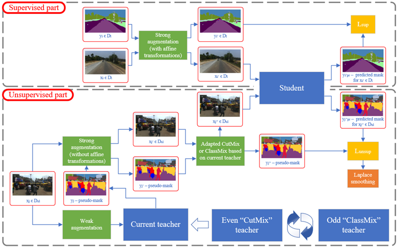

# Semi-supervised learning of a vision transformer for road traffic segmentation in an unstructured environment

Training notebook for a master's thesis on **semantic segmentation of road scenes in unstructured traffic** using a lightweight vision transformer (**EfficientViT-Seg B1**) and a **semi-supervised, two-teacher mean-teacher scheme** with confidence-aware CutMix / ClassMix. Experiments use the **Indian Driving Dataset (IDD)**, where roads are poorly delineated, traffic is dense and heterogeneous, and pixel-level labels are expensive to obtain.

> **This repository contains a single file:** [`efficientvit-training.ipynb`](efficientvit-training.ipynb). It was developed and run on **Kaggle** (GPU notebook), so several paths (`/kaggle/input/...`, `/kaggle/working/...`) are hard-coded.

---

## Table of contents

1. [Overview](#overview)
2. [Method](#method)
3. [Data](#data)
4. [Model](#model)
5. [Notebook walkthrough](#notebook-walkthrough)
6. [Configuration reference](#configuration-reference)
7. [Running the notebook](#running-the-notebook)
8. [Metrics and logging](#metrics-and-logging)
9. [Reproducibility](#reproducibility)
10. [References](#references)

---

## Overview

The goal is to obtain a compact, fast segmentation model that works on Indian roads with only a small fraction of annotated frames. The pipeline has two stages:

| Stage | What happens | Labeled data | Unlabeled data |
|---|---|---|---|
| **1. Supervised pre-training** | EfficientViT-B1 (Cityscapes-pretrained) is fine-tuned with a new 7-class head | small labeled subset | not used |
| **2. Semi-supervised fine-tuning** | Student + two EMA teachers; teachers produce pseudo-labels, student trains on mixed strongly-augmented images | same small labeled subset | large unlabeled subset (labels are never read) |

Key ingredients implemented in the notebook:

- Custom **hierarchical label sets** (26 / 16 / 7 classes) for IDD; the final experiments use the **7-class "high-level"** taxonomy.
- A **shape-aware batch sampler** so that IDD images of different resolutions are never mixed in one batch.
- A **custom RandAugment** for segmentation that transforms images and masks (and pixel-confidence maps) consistently.
- **Two EMA teachers** that alternate every epoch: one paired with **CutMix**, the other with **ClassMix**.
- **Confidence-adaptive mixing**: CutMix box size and ClassMix class selection depend on the teacher's confidence.
- Two **unlabeled-loss weighting** schemes: per-image fraction of confident pixels, or a **Laplace-style per-pixel weighting** that drops the least confident pixels.
- Fully seeded, deterministic-mode training with PyTorch Lightning.

## Method

### Stage 1 – supervised baseline

The pretrained Cityscapes EfficientViT-B1 segmentation model is loaded, its head is replaced with a randomly initialised head with 7 output classes, and the model is fine-tuned on the labeled subset.

- Loss: cross-entropy, `ignore_index = 7` (unlabeled / out-of-ROI pixels). Class weights are **not** used (`weights=None`).
- Optimiser: AdamW, weight decay `1e-4`, **differential learning rates**: backbone `1e-4`, head `1e-3`.
- Schedule: cosine with linear warm-up (8 epochs), up to 80 epochs, early stopping on validation mIoU (patience 10).
- Augmentation (`strong_transform_st`): `RandomResizedCrop` (scale 0.5–1, ratio 1.75–2.25) to 960×1920, horizontal flip, `CustomRandAug` (2 ops, including affine), resize to 416×832, normalisation with dataset mean/std.

### Stage 2 – semi-supervised fine-tuning

Each training step consumes a labeled mini-batch and an unlabeled mini-batch (`UNLAB_MULT` times larger):



**Two alternating teachers.** `teacher_even` and `teacher_odd` are deep copies of the student. On even epochs `teacher_even` generates pseudo-labels and the pipeline uses CutMix; on odd epochs `teacher_odd` is used together with ClassMix. Only the active teacher is updated by EMA after each optimiser step (`on_before_zero_grad`). Validation and testing evaluate the student and both teachers, and the best of the three (by mIoU) is tracked as `max_val_mIoU` / `max_test_mIoU`, which drives checkpointing and early stopping.

**Mixing strategies** (all operate on image, pseudo-label and confidence map together):

| Strategy | Modes | Behaviour |
|---|---|---|
| CutMix (`cut_mix`) | `ordinary` | Box size from `sqrt(1 − λ)`, `λ ~ Beta(4, 4)` |
| | `adapted` | `λ = c_a / (c_a + c_b)` where `c_a`/`c_b` are the mean confidence of the two images: the more confident image keeps more area (controlled by the value of `λ`) |
| ClassMix (`class_mix`) | `ordinary` | Half of the classes present in the source image are chosen uniformly at random and pasted |
| | `max` | The half of the present classes with the highest mean confidence |
| | `adapted` | Classes are sampled without replacement with probability proportional to their mean confidence |

**Unlabeled loss weighting** (`weighting`):

- `ordinary` – each image is weighted by the fraction of its pixels whose confidence is ≥ `confidence_threshold` (0.95).
- `laplace` – the lowest 20% of pixel confidences in the batch are masked out and the remaining pixels get weights proportional to `(confidence + 1)`, normalised so the mean weight over kept pixels is 1 (`calculate_pixel_weights`).

**Schedules for `mu` and the EMA decay** are pluggable: `mu_strategy ∈ {const, rampup}`, `ema_strategy ∈ {const, dynamical, rampup, lindecline}`.

## Data

**Dataset:** [Indian Driving Dataset – Segmentation](https://idd.insaan.iiit.ac.in/) (IDD), used through the Kaggle mirror `indian-driving-dataset`. Only **Part II** (`idd_seg_part_II`, 1080×1920 frames from video sequences) is used in the final experiments to stress the model by training on a small portion of data.

**Splits** (all drawn from Part II, seeded):

| Subset | Source | Share of Part II `train` | Use |
|---|---|---|---|
| Labeled train | `random_split` of Part II `train` | ≈ 5.32 % | supervised loss (both stages) |
| Unlabeled train | `random_split` of Part II `train` | ≈ 37.25 % | pseudo-labelling (**masks are loaded by the dataset class but discarded**) |
| Validation | `random_split` of Part II `train` | ≈ 10.02 % | model selection / early stopping |
| Unused | remainder | ≈ 47.40 % | not used |
| Test | official Part II `val` split | all | final evaluation |

**Expected directory layout** (as read by `IDD_Dataset`):

```
<root>/                                   # e.g. /kaggle/input/indian-driving-dataset
├── IDD/
│   ├── idd_seg_part_II_leftImg8bit/{train,val,test}/<seq>/<frame>_leftImg8bit.jpg
│   └── idd_seg_part_II_gtFine/{train,val}/<seq>/<frame>_gtFine_polygons.npz      # 26-class ("low") masks
└── high_level_labels/                    # produced outside this notebook
    └── idd_seg_part_II_gtFine_high/{train,val}/<seq>/<frame>_gtFine_polygons.npz
```

Each `.npz` must contain a `masks` array (H×W, integer class ids). Masks for the 7-class taxonomy are **pre-computed by mapping the 26 IDD labels to coarser groups**; this mapping script is *not* part of this notebook (the notebook only contains the class-name lists).

**Label hierarchies** (last id in each list is the ignore label and is never trained on):

- **High (7 classes, used for the final experiments):** `drivable`, `non-drivable`, `living things`, `vehicles`, `road side objects`, `far objects`, `sky`.
- **Middle (16 classes):** `road`, `other drivable`, `sidewalk`, `other non-drivable`, `living being`, `rider`, `small/medium/large vehicle`, `edge boundary`, `barrier`, `information road side object`, `support structures`, `large infrastructure`, `vegetation`, `sky`.
- **Low (26 classes):** the original IDD level-3 classes (`road`, `parking/drivable fallback`, `sidewalk`, …, `sky/fallback background`).

Switch taxonomy via `CURRENT_LEVEL_MAPPING` / `CURRENT_HIERARCHY_STR` in the constants cell.

**Pre-computed statistics** (loaded from a Kaggle dataset named `efficientvit-checkpoint`; code to regenerate them is in commented cells):

- `channel_mean_data_ii_1_9lab.npy`, `channel_std_data_ii_1_9lab.npy` – per-channel RGB mean/std used for normalisation.
- `class_weights.npy` – inverse-frequency class weights (currently unused).

## Model

Custom`EfficientViTSegMod` based on `EfficientViTSeg` from the [EfficientViT](https://github.com/mit-han-lab/efficientvit) code base with modified head (7 classes) and added **×8 bicubic upsampling** of the logits inside `forward`.

- Backbone: **EfficientViT-B1** (Cityscapes-pretrained weights from `assets/checkpoints/seg/cityscapes/b1.pt`).
- Head: `SegHead` on stages 4/3/2 (strides 32/16/8), width 64, depth 3, MBConv middle ops, **7 output classes**.
- Size (from the notebook's `torchinfo` output at input 1×3×416×832): **≈ 4.80 M parameters, ≈ 4.08 GMACs**.
- Optional stochastic depth wrappers (`StochasticDepth`, `add_stohastic_depth`, `blocks_modified_paths`) experiments are implemented but **disabled** in the final runs.

Cityscapes-pretrained backbone is used, because both Cityscapes and IDD contain images from a car dashcam, so the transfer learning concept can be applied.

Input geometry: full frames (1080×1920) are centre-cropped to **960×1920** and resized to **416×832** for training and inference.

## Notebook walkthrough

| Section | Contents |
|---|---|
| **Environment** | Sets `CUBLAS_WORKSPACE_CONFIG` for determinism; clones the EfficientViT fork; installs `lightning==2.2.5`, `torchmetrics==1.4.0.post0`, `torchvision==0.16.0`, `torchinfo`, `torch-ema`, `segmentation-models-pytorch` |
| **Imports** | PyTorch, torchvision v2 transforms, Lightning, torchmetrics, EfficientViT modules |
| **Transformation testing** | Commented-out scratch cells for checking transforms on masks |
| **CustomRandAug** | RandAugment for segmentation: photometric ops applied to the image only; geometric ops (`rotate`, `shear_x/y`, `trans_x/y`) applied to image, mask and confidence map with mask-appropriate interpolation and fill (ignore label filling for masks, 0 - for confidence). Supports `discrete` and `logits` mask formats |
| **Const variables** | Batch sizes, resolutions, label hierarchies, colour maps, normalisation stats, class weights |
| **Reproducibility** | Global and per-loader seeds, deterministic cuDNN, worker seeding |
| **Model definition** | `EfficientViTSegMod`, model zoo helpers, head replacement, stochastic-depth utilities, `torchinfo` summary |
| **Dataset** | `IDD_Dataset`, `SameShapeSampler`, `SameShapeBatchSampler`, `apply_model_and_show_results` visualisation helper |
| **Augmentations** | `strong_transform_st`, `pre/post_strong_transform_sst`, `weak_transform_i/ii`, `inference_transform` |
| **Dataloaders** | Split creation and all loaders (labeled supervised, labeled semi-supervised, unlabeled, validation, test) |
| **Additional info calculation** | Commented-out code that computes channel mean/std and class weights |
| **Augmentation visualisations** | Commented-out cells to experiment with augmentations |
| **Lightning Modules → Supervised training** | `LitSegSupervised` (train/val/test steps, metrics, qualitative overlays, AdamW + cosine warm-up) and the (commented-out) Stage 1 training/test calls |
| **Semi-supervised finetune** | `LitSegSemiSupervised` (two EMA teachers, CutMix, ClassMix, confidence weighting, teacher evaluation) and the Stage 2 training call |

## Configuration reference

**Global constants**

| Name | Value | Meaning |
|---|---|---|
| `RAND_CONST` | `10` | Base random seed |
| `BATCH_SIZE_ST` | `10` | Labeled batch size, supervised stage, also val/test |
| `BATCH_SIZE_SST` | `2` | Labeled batch size, semi-supervised stage |
| `UNLAB_MULT` | `4` | Unlabeled batch = `UNLAB_MULT × BATCH_SIZE_SST` = 8 |
| `CENTER_CROP_*` | `960 × 1920` | Crop of the raw 1080×1920 frame |
| `NEW_HEIGHT/WIDTH` (`_FT`) | `416 × 832` | Network input size |
| `DECAY_VAL` | `0.99` | EMA decay of the teachers |
| `CURRENT_LEVEL_MAPPING` | `HIGH_LEVEL_MAPPING` | 7 trained classes + 1 ignore |

**Stage 1 (`LitSegSupervised`)**

| Hyper-parameter | Value |
|---|---|
| Epochs / early stopping | 80 / patience 10 on `val_mIoU` |
| LR backbone / head | `1e-4` / `1e-3` |
| Weight decay | `1e-4` |
| Warm-up | 8 epochs (cosine decay afterwards) |
| Class weights | none |

**Stage 2 (`LitSegSemiSupervised`, configuration in the training cell)**

| Hyper-parameter | Value |
|---|---|
| Init | supervised `.pth` from Stage 1 |
| Epochs | `max_epochs=80`, `min_epochs=50`, early stopping patience 10 on `max_val_mIoU` |
| LR backbone / head | `5e-4` / `2e-3` (AdamW, wd `1e-4`) |
| Warm-up | 8 epochs |
| `mu` / `mu_strategy` | `5` / `const` |
| EMA decay / strategy | `0.99` / `const` |
| Weighting | `laplace` (`confidence_threshold=0.95` only matters for `ordinary`) |
| CutMix mode | `adapted` |
| ClassMix mode | `ordinary` |
| Loader reload | `reload_dataloaders_every_n_epochs=1` |

## Running the notebook

### GPU training was performed on Kaggle

1. Create a Kaggle notebook with a **GPU** accelerator and upload `efficientvit-training.ipynb`.
2. Attach the datasets referenced in the notebook:
   - `indian-driving-dataset` (IDD segmentation, including the 7-class `high_level_labels` masks described in [Data](#data));
   - a dataset called `efficientvit-checkpoint` containing the `.npy` statistics and, for Stage 2, the Stage 1 `.pth` model and `last.ckpt`.
3. Run the **Environment** cells. Note: the `conda create` / `!activate` lines are a leftover; if the environment does not switch, just proceed with `pip install` into the default interpreter.
4. Run all cells up to **Dataloaders**.
5. **Stage 1:** uncomment the cells under *Supervised training* and run them. This produces a Lightning checkpoint and (optionally) a full-model `.pth` via `torch.save(lit_model.seg_model, ...)`.
6. **Stage 2:** point `model_b1_prt = torch.load(...)` at your Stage 1 `.pth`, adjust `ckpt_path` (the notebook resumes from a prior `last.ckpt` after stripping `current_teacher*` keys; remove that argument for a fresh run), and run the training cell.
7. Optionally evaluate with `trainer.test(lit_model_b1, test_loader, ckpt_path=...)` (commented-out cell).

### Software versions pinned in the notebook

`python 3.10`, `lightning 2.2.5`, `torchmetrics 1.4.0.post0`, `torchvision 0.16.0` (plus the packages in the EfficientViT `requirements.txt`, `torchinfo`, `torch-ema`, `segmentation-models-pytorch`, `transformers` for the cosine scheduler).

## Metrics and logging

All metrics are **macro-averaged** over the 7 classes with the ignore label excluded (`torchmetrics`): mIoU (Jaccard), Dice, precision, recall, accuracy. They are logged for training (labeled and unlabeled/pseudo-label branches separately), validation (student + both teachers) and test (student + both teachers), to **TensorBoard** via `TensorBoardLogger('lightning_logs', ...)`. Additional logged quantities in Stage 2: `train_unlabeled_loss`, the ratio of confident pixels (`ordinary`) or the 20th-percentile confidence threshold (`laplace`), and `max_val_mIoU` / `max_test_mIoU`. Qualitative image / prediction / ground-truth overlays for a fixed set of control frames are rendered at the end of validation (every `output_epoch` epochs) and testing.

## Reproducibility

- Seeds for Python, NumPy, PyTorch (CPU + CUDA) and a dedicated `torch.Generator` for every loader; `seed_worker` seeds DataLoader workers; `L.seed_everything(RAND_CONST, workers=True)` before Stage 2.
- `torch.backends.cudnn.deterministic = True`, `benchmark = False`, `CUBLAS_WORKSPACE_CONFIG=':4096:8'`, `torch.use_deterministic_algorithms(True, warn_only=True)`, `Trainer(deterministic='warn')` in Stage 2.
- Because mixed-resolution batches are avoided by `SameShapeBatchSampler`, batch composition depends on the seeded generators. Even so, bit-exact reproduction across GPU models or library versions is not guaranteed.

## References

- Cai et al., *EfficientViT: Lightweight Multi-Scale Attention for On-Device Semantic Segmentation*, ICCV 2023 – [code](https://github.com/mit-han-lab/efficientvit).
- Varma et al., *IDD: A Dataset for Exploring Problems of Autonomous Navigation in Unconstrained Environments*, WACV 2019 – [dataset](https://idd.insaan.iiit.ac.in/).
- Tarvainen & Valpola, *Mean teachers are better role models*, NeurIPS 2017.
- Yun et al., *CutMix*, ICCV 2019.
- Olsson et al., *ClassMix: Segmentation-Based Data Augmentation for Semi-Supervised Learning*, WACV 2021.
- Sohn et al., *FixMatch*, NeurIPS 2020.
- Cubuk et al., *RandAugment*, CVPRW 2020; segmentation adaptation based on [RegSeg](https://github.com/RolandGao/RegSeg) (`augment.py`).
- Lightning, torchmetrics, torchvision v2 transforms.
